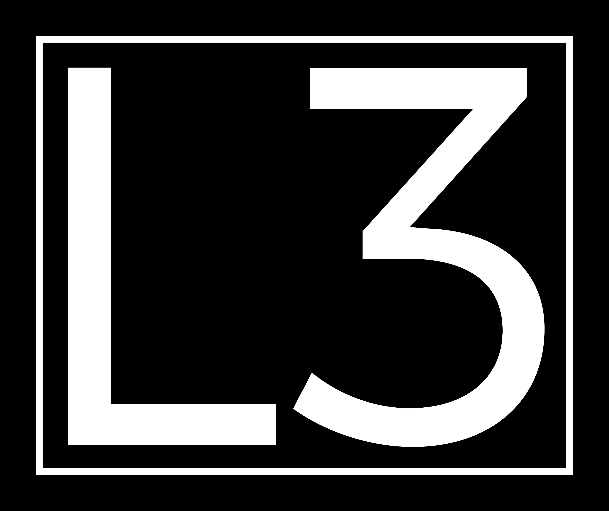

# Leanimum-agent

A minimal bash-only agent for Lean proofs and programs, based on
[mini-swe-agent](https://github.com/SWE-agent/mini-swe-agent).

- **Minimal**: A small Python implementation of the [agent class](https://github.com/cmu-l3/Leanimum-agent/blob/main/src/leanimum/agents/default.py) (and a bit more for the [environment](https://github.com/cmu-l3/Leanimum-agent/blob/main/src/leanimum/environments/local.py),
[model](https://github.com/cmu-l3/Leanimum-agent/blob/main/src/leanimum/models/litellm_model.py), and [run script](https://github.com/cmu-l3/Leanimum-agent/blob/main/src/leanimum/run/hello_world.py)) — no fancy dependencies!
- **Deployable:** Supports **local environments**, **docker/podman**, **singularity/apptainer**, **bublewrap**, **contree**, and more
- **Compatible:** Supports all models via **litellm**, **openrouter**, **portkey**, and more. Support for `/completion` and `/response` endpoints, interleaved thinking etc.

<details>

<summary>More motivation (for research)</summary>

The `leani` agent

- **Does not have any tools other than bash** — it doesn't even need to use the tool-calling interface of the LMs.
  This means that you can run it with literally any model. When running in sandboxed environments you also don't need to take care
  of installing a single package — all it needs is bash.
- **Has a completely linear history** — every step of the agent just appends to the messages and that's it.
  So there's no difference between the trajectory and the messages that you pass on to the LM.
  Great for debugging & fine-tuning.
- **Executes actions with `subprocess.run`** — every action is completely independent (as opposed to keeping a stateful shell session running).
  This makes it trivial to execute the actions in sandboxes (literally just switch out `subprocess.run` with `docker exec`) and to
  scale up effortlessly. Seriously, this is [a big deal](docs/faq.md#why-no-shell-session), trust me.

This makes it perfect as a baseline system and for a system that puts the language model (rather than
the agent scaffold) in the middle of our attention.

</details>

<details>
<summary>More motivation (as a tool)</summary>

Some agents are overfitted research artifacts. Others are UI-heavy frontend monsters.

The `leani` agent wants to be a hackable tool, not a black box.

- **Simple** enough to understand at a glance
- **Convenient** enough to use in daily workflows
- **Flexible** to extend

- **Does not have any tools other than bash** — it doesn't even need to use the tool-calling interface of the LMs.
  Instead of implementing custom tools for every specific thing the agent might want to do, the focus is fully on the LM utilizing the shell to its full potential.
  Want it to do something specific like opening a PR?
  Just tell the LM to figure it out rather than spending time to implement it in the agent.
- **Executes actions with `subprocess.run`** — every action is completely independent (as opposed to keeping a stateful shell session running).
  This is [a big deal](docs/faq.md#why-no-shell-session) for the stability of the agent, trust me.
- **Has a completely linear history** — every step of the agent just appends to the messages that are passed to the LM in the next step and that's it.
  This is great for debugging and understanding what the LM is prompted with.

</details>

<table width="100%">
<tr>
<td width="50%">
<a href="docs/usage/mini.md"><strong>CLI</strong></a> (<code>leani</code>)
</td>
<td width="50%">
<a href="docs/usage/reuf2f.md"><strong>Batch inference</strong></a>
</td>
</tr>
<tr>
<td width="50%">

```bash
cd /path/to/lean-project
leani -c mini.yaml \
  -t "Prove the theorem"
```

</td>
<td>

```bash
leani-extra reuf2f \
  --subset ./test.jsonl \
  --filter '^gu2020hat$' \
  -m YOUR_MODEL \
  -o /tmp/reuf2f-run
```

</td>
</tr>
<tr>
<td>
<a href="docs/usage/inspector.md"><strong>Trajectory browser</strong></a>
</td>
<td>
<a href="docs/advanced/cookbook.md"><strong>Python bindings</strong></a>
</td>
</tr>
<tr>
<td>

```bash
leani-extra inspect ./run
```

</td>
<td>

```python
cfg = get_config_from_spec(
    "mini"
)
agent = DefaultAgent(
    get_model(
        "YOUR_MODEL",
        cfg["model"],
    ),
    LocalEnvironment(cwd="."),
    **cfg["agent"],
)
agent.run("Prove the theorem")
```

</td>
</tr>
</table>

## Let's get started!

**Option 1:** If you just want to try out the CLI (package installed in anonymous virtual environment)

```bash
pip install uv && uvx --from "git+https://github.com/cmu-l3/Leanimum-agent.git" leani
# or
pip install pipx && pipx ensurepath && pipx run --spec "git+https://github.com/cmu-l3/Leanimum-agent.git" leani
```

**Option 2:** Install CLI & python bindings in current environment

```bash
pip install "git+https://github.com/cmu-l3/Leanimum-agent.git"
leani  # run the CLI
```

**Option 3:** Install from source (developer setup)

```bash
git clone https://github.com/cmu-l3/Leanimum-agent.git
cd Leanimum-agent && pip install -e .
leani  # run the CLI
```

Read more in our [documentation](docs/index.md):

* [Quick start guide](docs/quickstart.md)
* [Using the `leani` CLI](docs/usage/mini.md)
* [Global configuration](docs/advanced/global_configuration.md)
* [Yaml configuration files](docs/advanced/yaml_configuration.md)
* [Power up with the cookbook](docs/advanced/cookbook.md)
* [FAQ](docs/faq.md)
* [Contribute!](docs/contributing.md)

## Attribution

If you find our work helpful, please use the following citation.

```bibtex
@article{zheng2026reuf2f,
  title={ReuF2F: Benchmarking coding agents on formalized undergraduate research problems},
  author={Zheng, Zeyu and Liu, Yiyang and Zhao, Yuyang and Zheng, Congmin and Zhu, Jiachen and Chen, Jianian and Zhang, Kangning and Wong, Kayue Daniel and Yang, Lingyu and Shan, Rong and Chen, Shihao and Zhu, Thomas and Zhang, Wentao and Li, Xiaopeng and Hu, Yan and Lin, Yongxi and Chen, Yuxiang and Ou, Zhuoying and Lin, Jianghao and Avigad, Jeremy and Tetali, Prasad and Chen, Jingbang and Welleck, Sean},
  journal={Preprint},
  year={2026}
}
```

## Other projects

<table align="center">
  <tr>
    <td align="center">
      <p align="center"><a href="https://github.com/cmu-l3/llmlean"><br/>LLMLean</a></p>
    </td>
    <td align="center">
      <p align="center"><a href="https://github.com/cmu-l3/ntp-toolkit"><br/>ntp-toolkit</a></p>
    </td>
    <td align="center">
      <p align="center"><a href="https://github.com/cmu-l3/minictx-eval"><br/>miniCTX-eval</a></p>
    </td>
    <td align="center">
      <p align="center"><a href="https://github.com/cmu-l3/alphaverus"><br/>AlphaVerus</a></p>
    </td>
    <td align="center">
      <p align="center"><a href="https://github.com/zeyu-zheng/FAR"><br/>FAR</a></p>
    </td>
    <td align="center">
      <p align="center"><a href="https://github.com/cmu-l3/reuF2F"><br/>reuF2F</a></p>
    </td>
  </tr>
</table>
